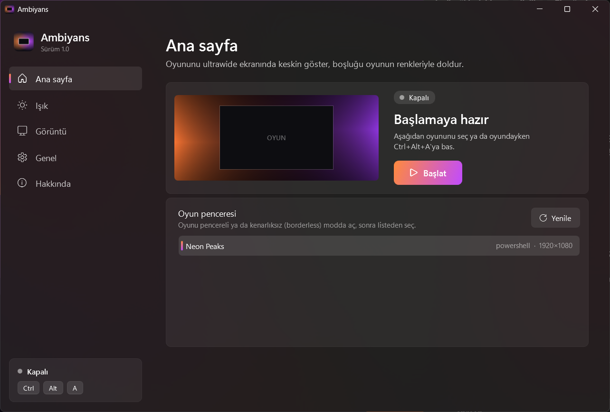

<p align="center"></p>

<h1 align="center">Ambiyans</h1>

<p align="center">
Ultrawide monitörlerde düşük çözünürlükte oynanan oyunları <b>bulanıklaştırmadan</b> gösterir,<br>
oyunun etrafındaki boşluğu televizyonlardaki gibi <b>ambiyans ışığıyla</b> doldurur.<br>
<i>Sharp games and ambient light for ultrawide monitors — <a href="#english">English below</a>.</i>
</p>

<p align="center"></p>

---

## Neden?

3440×1440 bir ekranda oyunu 1920×1080'de oynamak için Windows çözünürlüğünü düşürünce görüntü **bulanıklaşır**:
1080 satır 1440 satıra 1,33 kat büyütülür ve pikseller birbirine karışır.

Ambiyans bunun yerine oyunu **pencerede, piksel piksel birebir** gösterir ve kenarlardaki boşluğu oyunun kendi renkleriyle aydınlatır.
İstersen görüntüyü Windows'un kendi büyütme sistemiyle **FPS kaybetmeden** ekranı dolduracak kadar büyütür.

## Özellikler

- **Ambiyans ışığı:** Oyunun kenar renkleri ekranın boş kısmına yumuşakça yayılır. Sade (sadece renk) ve Detaylı stiller.
- **Keskin görüntü:** Oyun penceresi kenarlıksız yapılır, istediğin boyuta (1920×1080 … 2560×1440) getirilir ve ortalanır.
- **Görüntüyü büyüt:** Oyun aynı sayıda piksel çizer, Windows ekranda büyük gösterir. FPS'e etkisi yok.
- **Çok hafif:** Görüntü ekran kartıyla yakalanır. İşlemci kullanımı ~%1.
- **Güvenli:** Oyunun belleğine ya da dosyalarına dokunmaz, sadece ekranda görünen görüntüyü okur.
- 12 dilde arayüz (Türkçe, English, Español, Português, Français, Deutsch, Русский, 中文, 日本語, 한국어, Italiano, Polski), Windows ile başlatma, kısayollar.

## Kurulum

- **Microsoft Store:** "Ambiyans" diye arat ve **Yükle**'ye bas. *(önerilen — otomatik güncellenir)*
- **Elle:** [Releases](../../releases) sayfasından `Ambiyans-x.y.z-win-x64.zip` dosyasını indir, aç ve `Ambiyans.exe`'yi çalıştır.
  İmzasız olduğu için Windows "bilinmeyen yayıncı" uyarısı verebilir: **Ek bilgi → Yine de çalıştır**.

Gereksinim: Windows 10 (2004+) ya da Windows 11, 64 bit.

## Kullanım

1. Oyunu **pencereli** ya da **kenarlıksız (borderless)** modda aç. *(Tam ekran modunda çalışmaz.)*
2. Ambiyans'ı aç, listeden oyun penceresini seç ve **Başlat**'a bas.
   Ya da oyundayken **Ctrl+Alt+A**'ya bas.
3. Durdurmak için yine **Ctrl+Alt+A** ya da **Durdur**.

| Kısayol | İşlev |
|---|---|
| Ctrl+Alt+A | Ambiyansı aç / kapat (o an aktif pencerede) |
| Ctrl+Alt+Z | Büyütmeyi anında aç / kapat |

## Sık sorulanlar

**Anti-cheat sorun çıkarır mı?** Ambiyans oyunun belleğine dokunmaz, ekran kaydı programlarıyla (OBS gibi) aynı yöntemle görüntü okur ve pencereyi taşır. Yine de her oyunun anti-cheat sistemi için garanti verilemez.

**Menülerde fare kayıyor.** Büyütme açıkken Windows sadece görüntüyü büyütür. Menüdeyken **Ctrl+Alt+Z** ile büyütmeyi kapatıp maçta tekrar aç.

**Kenarlar siyah kalıyor.** Bazı oyunlar ekran yakalamayı engeller; o zaman ışık oluşamaz.

## Gizlilik

Ambiyans hiçbir veri toplamaz ve internete bağlanmaz. Ayrıntılar: [PRIVACY.md](PRIVACY.md)

## Derleme

Windows 10/11 + Windows SDK yeterli (Visual Studio gerekmez):

```
powershell -ExecutionPolicy Bypass -File Ambiyans\build.ps1      # exe
powershell -ExecutionPolicy Bypass -File Ambiyans\package.ps1    # MSIX + zip
```

## Lisans

[MIT](LICENSE) — ücretsiz, açık kaynak.

---

<a id="english"></a>
## English

**Ambiyans** shows games played at a lower resolution on ultrawide monitors **pixel-sharp**, without the blur you get from lowering the Windows resolution, and fills the empty space around the game with **ambient light** made from the game's own colors — like a TV's ambient lighting.

<p align="center"></p>

**Features**
- Ambient light that follows the game's edge colors (Soft or Detailed style).
- Removes the game window's borders, resizes it (1920×1080 … 2560×1440) and centers it.
- Optional scaling through Windows' own magnifier: the game renders the same pixels, Windows shows them larger — **no FPS cost**.
- Captures the screen on the GPU: about 1% CPU.
- Never touches the game's memory or files.
- Interface in 12 languages: English, Turkish, Spanish, Portuguese, French, German, Russian, Chinese, Japanese, Korean, Italian, Polish.

**Install:** search for "Ambiyans" in the Microsoft Store, or download the zip from [Releases](../../releases).
**Use:** run the game in windowed or borderless mode, pick it in Ambiyans and press **Start** — or press **Ctrl+Alt+A** in game. **Ctrl+Alt+Z** toggles scaling.

Ambiyans collects no data and makes no network connections ([PRIVACY.md](PRIVACY.md)). Licensed under [MIT](LICENSE).
