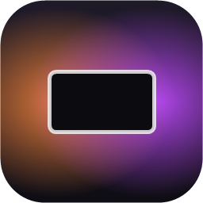
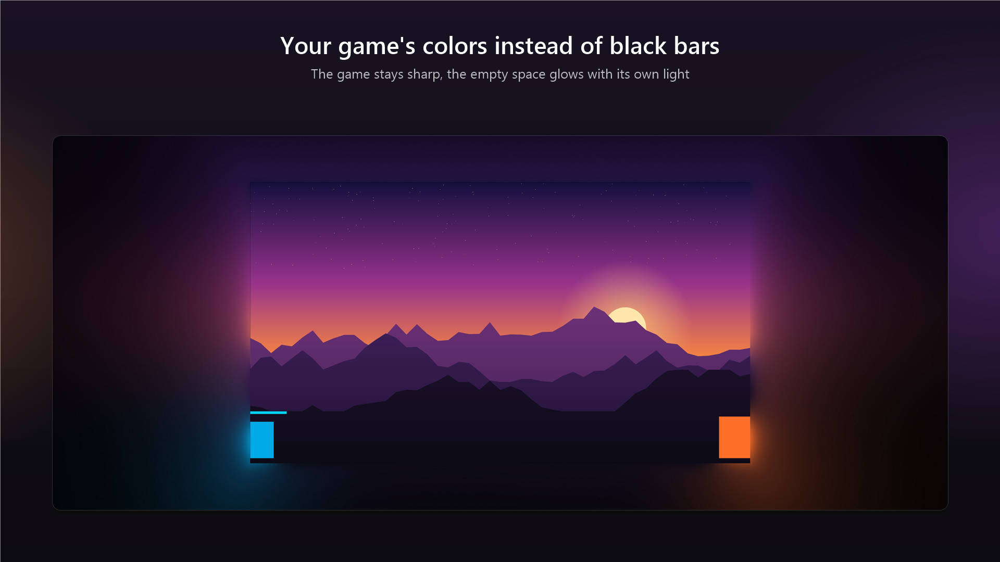

<p align="center"></p>

<h1 align="center">Ambiance Ultrawide</h1>

<p align="center">
<b>Ambient light synced to your game</b> for ultrawide monitors:<br>
the black bars around a 16:9 game glow with the scene, like a TV's ambient lighting, and the game stays <b>pixel-sharp</b>.<br>
<i><a href="#türkçe">Türkçe aşağıda</a></i>
</p>

<p align="center">
<a href="https://apps.microsoft.com/detail/9N5WW64LNMSH?mode=direct"></a>
<br><a href="https://aahmetcaglarr.github.io/AmbianceUltrawide/">Website</a> · 12 languages · free and open source
</p>

<p align="center"></p>

---

## Why?

To play a game at 1920×1080 on a 3440×1440 monitor, most people lower the Windows resolution — and everything turns **blurry**: 1080 lines get stretched 1.33× to fill 1440, so the pixels smear together.

Ambiance Ultrawide takes a different route. It shows the game **in a window, pixel for pixel**, and lights up the empty space at the sides with the game's own colors, like a TV's ambient lighting.
If you want, it can also enlarge the image to fill the screen using Windows' own magnifier — **with no FPS cost**.

## Features

- **Ambient light:** the colors at the game's edges glow softly into the empty space. Soft (color only) and Detailed styles.
- **Sharp image:** removes the game window's borders, resizes it to the size you pick (1920×1080 … 2560×1440) and centers it.
- **Enlarge image:** the game renders the same number of pixels and Windows shows them larger. No FPS cost.
- **Lightweight:** captures the screen on the GPU — about 1% CPU.
- **Safe:** never touches the game's memory or files; it only reads what is shown on screen.
- Interface in **12 languages**: English, Español, Português, Français, Deutsch, Русский, 中文, 日本語, 한국어, Italiano, Polski, Türkçe.
- Start with Windows, global shortcuts.

<p align="center"></p>

## Install

- **[Microsoft Store](https://apps.microsoft.com/detail/9N5WW64LNMSH):** click **Install** *(recommended — updates automatically)*.
- **Manual:** download `AmbianceUltrawide-x.y.z-win-x64.zip` from [Releases](../../releases), unzip it and run `AmbianceUltrawide.exe`.
  Because the exe isn't code-signed yet, Windows may show an "unknown publisher" warning: click **More info → Run anyway**.

Requires Windows 10 (2004+) or Windows 11, 64-bit.

## Usage

1. Run your game in **windowed** or **borderless** mode. *(Exclusive fullscreen is not supported.)*
2. Open Ambiance Ultrawide, pick the game window from the list and press **Start** — or press **Ctrl+Alt+A** while in game.
3. Press **Ctrl+Alt+A** again (or **Stop**) to turn it off.

| Shortcut | Action |
|---|---|
| Ctrl+Alt+A | Turn ambient light on / off (on the active window) |
| Ctrl+Alt+Z | Toggle scaling instantly |

## FAQ

**Will anti-cheat complain?** Ambiance Ultrawide never touches the game's memory. It reads the screen the same way recording apps like OBS do, and moves/resizes the window. Still, no guarantee can be given for every game's anti-cheat.

**The mouse cursor is offset in menus.** With scaling on, Windows only enlarges the image. Press **Ctrl+Alt+Z** to turn scaling off in menus and back on in the match.

**The sides stay black.** Some games block screen capture; then the light can't be created.

## iPad and other browsers: Ambiance Video

**Ambiance Video** brings the same idea to videos in Safari on iPad (and any browser with a userscript manager): tap a video, press **Ambiance**, and it goes fullscreen with the black bars glowing in sync with the scene. Works on YouTube and most other sites. DRM-protected services (Netflix, Disney+ etc.) block it.

1. Install the free **[Userscripts](https://apps.apple.com/app/userscripts/id1463298887)** app from the App Store, open it once and pick a folder for scripts.
2. In **Settings → Apps → Safari → Extensions → Userscripts**, turn it on and allow it on all websites.
3. In Safari, open **[ambiance-video.user.js](https://aahmetcaglarr.github.io/AmbianceUltrawide/ambiance-video.user.js)**, tap the Userscripts icon in the address bar and choose **Install**.

On desktop, the same file works with Tampermonkey or Violentmonkey.

## Privacy

Ambiance Ultrawide collects no data and makes no network connections. Details: [PRIVACY.md](PRIVACY.md)

## Build from source

Windows 10/11 + the Windows SDK is all you need (no Visual Studio):

```
powershell -ExecutionPolicy Bypass -File src\build.ps1      # exe
powershell -ExecutionPolicy Bypass -File src\package.ps1    # MSIX + zip
```

## License

[MIT](LICENSE) — free and open source.

---

<a id="türkçe"></a>
## Türkçe

**Ambiance Ultrawide**, ultrawide monitörün için **oyundaki sahneyle senkron ambiyans ışığı**. Oyunun etrafındaki siyah boşlukları, televizyonlardaki gibi sahneyle birlikte değişen yumuşak bir ışıkla doldurur. Oyun da Windows çözünürlüğünü düşürmenin yarattığı bulanıklık olmadan **piksel piksel keskin** kalır.

<p align="center"></p>

**Özellikler**
- Oyunun kenar renklerini takip eden ambiyans ışığı (Sade ya da Detaylı stil).
- Oyun penceresini kenarlıksız yapar, istediğin boyuta getirir (1920×1080 … 2560×1440) ve ortalar.
- Windows'un kendi büyütme sistemiyle **FPS kaybı olmadan** ekranı doldurma.
- Görüntüyü ekran kartıyla yakalar, işlemci kullanımı yaklaşık %1.
- Oyunun belleğine ya da dosyalarına dokunmaz.

**Kurulum:** [Microsoft Store](https://apps.microsoft.com/detail/9N5WW64LNMSH?hl=tr-tr)'dan yükle ([Türkçe tanıtım sayfası](https://aahmetcaglarr.github.io/AmbianceUltrawide/tr/)) ya da [Releases](../../releases) sayfasından zip'i indir.
**Kullanım:** Oyunu pencereli ya da kenarlıksız modda aç, Ambiance Ultrawide'da listeden seç ve **Başlat**'a bas. Ya da oyundayken **Ctrl+Alt+A**'ya bas. **Ctrl+Alt+Z** büyütmeyi açıp kapatır.

**iPad:** Safari'deki videolar için **Ambiance Video** betiği var: yukarıdaki "iPad and other browsers" bölümündeki üç adımla kurulur. YouTube ve çoğu sitede çalışır; Netflix gibi DRM'li servisler izin vermez.

Ambiance Ultrawide hiçbir veri toplamaz ve internete bağlanmaz ([PRIVACY.md](PRIVACY.md)). [MIT](LICENSE) lisanslıdır.
