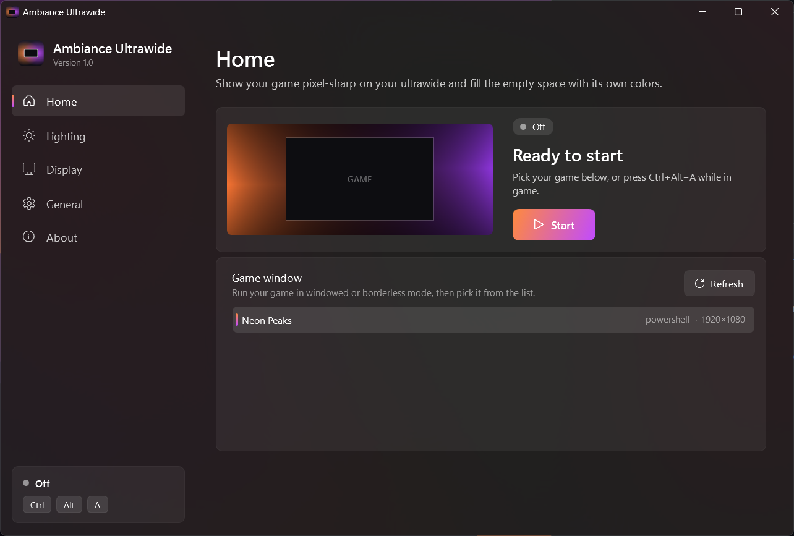

<p align="center"></p>

<h1 align="center">Ambiyans</h1>

<p align="center">
Shows games <b>pixel-sharp</b> on ultrawide monitors — no blur —<br>
and fills the empty space around them with <b>ambient light</b> made from the game's own colors.<br>
<i><a href="#türkçe">Türkçe aşağıda</a></i>
</p>

<p align="center"></p>

---

## Why?

To play a game at 1920×1080 on a 3440×1440 monitor, most people lower the Windows resolution — and everything turns **blurry**: 1080 lines get stretched 1.33× to fill 1440, so the pixels smear together.

Ambiyans takes a different route. It shows the game **in a window, pixel for pixel**, and lights up the empty space at the sides with the game's own colors, like a TV's ambient lighting.
If you want, it can also enlarge the image to fill the screen using Windows' own magnifier — **with no FPS cost**.

## Features

- **Ambient light:** the colors at the game's edges glow softly into the empty space. Soft (color only) and Detailed styles.
- **Sharp image:** removes the game window's borders, resizes it to the size you pick (1920×1080 … 2560×1440) and centers it.
- **Enlarge image:** the game renders the same number of pixels and Windows shows them larger. No FPS cost.
- **Lightweight:** captures the screen on the GPU — about 1% CPU.
- **Safe:** never touches the game's memory or files; it only reads what is shown on screen.
- Interface in **12 languages**: English, Español, Português, Français, Deutsch, Русский, 中文, 日本語, 한국어, Italiano, Polski, Türkçe.
- Start with Windows, global shortcuts.

<p align="center"></p>

## Install

- **Microsoft Store:** search for "Ambiyans" and click **Install** *(recommended — updates automatically)*.
- **Manual:** download `Ambiyans-x.y.z-win-x64.zip` from [Releases](../../releases), unzip it and run `Ambiyans.exe`.
  Because the exe isn't code-signed yet, Windows may show an "unknown publisher" warning: click **More info → Run anyway**.

Requires Windows 10 (2004+) or Windows 11, 64-bit.

## Usage

1. Run your game in **windowed** or **borderless** mode. *(Exclusive fullscreen is not supported.)*
2. Open Ambiyans, pick the game window from the list and press **Start** — or press **Ctrl+Alt+A** while in game.
3. Press **Ctrl+Alt+A** again (or **Stop**) to turn it off.

| Shortcut | Action |
|---|---|
| Ctrl+Alt+A | Turn ambient light on / off (on the active window) |
| Ctrl+Alt+Z | Toggle scaling instantly |

## FAQ

**Will anti-cheat complain?** Ambiyans never touches the game's memory. It reads the screen the same way recording apps like OBS do, and moves/resizes the window. Still, no guarantee can be given for every game's anti-cheat.

**The mouse cursor is offset in menus.** With scaling on, Windows only enlarges the image. Press **Ctrl+Alt+Z** to turn scaling off in menus and back on in the match.

**The sides stay black.** Some games block screen capture; then the light can't be created.

## Privacy

Ambiyans collects no data and makes no network connections. Details: [PRIVACY.md](PRIVACY.md)

## Build from source

Windows 10/11 + the Windows SDK is all you need (no Visual Studio):

```
powershell -ExecutionPolicy Bypass -File Ambiyans\build.ps1      # exe
powershell -ExecutionPolicy Bypass -File Ambiyans\package.ps1    # MSIX + zip
```

## License

[MIT](LICENSE) — free and open source.

---

<a id="türkçe"></a>
## Türkçe

**Ambiyans**, ultrawide monitörlerde düşük çözünürlükte oynanan oyunları Windows çözünürlüğünü düşürmenin yarattığı bulanıklık olmadan, **piksel piksel keskin** gösterir. Oyunun etrafındaki boşluğu da televizyonlardaki gibi oyunun kendi renklerinden oluşan **ambiyans ışığıyla** doldurur.

<p align="center"></p>

**Özellikler**
- Oyunun kenar renklerini takip eden ambiyans ışığı (Sade ya da Detaylı stil).
- Oyun penceresini kenarlıksız yapar, istediğin boyuta getirir (1920×1080 … 2560×1440) ve ortalar.
- Windows'un kendi büyütme sistemiyle **FPS kaybı olmadan** ekranı doldurma.
- Görüntüyü ekran kartıyla yakalar, işlemci kullanımı yaklaşık %1.
- Oyunun belleğine ya da dosyalarına dokunmaz.

**Kurulum:** Microsoft Store'da "Ambiyans" diye arat ya da [Releases](../../releases) sayfasından zip'i indir.
**Kullanım:** Oyunu pencereli ya da kenarlıksız modda aç, Ambiyans'ta listeden seç ve **Başlat**'a bas. Ya da oyundayken **Ctrl+Alt+A**'ya bas. **Ctrl+Alt+Z** büyütmeyi açıp kapatır.

Ambiyans hiçbir veri toplamaz ve internete bağlanmaz ([PRIVACY.md](PRIVACY.md)). [MIT](LICENSE) lisanslıdır.
